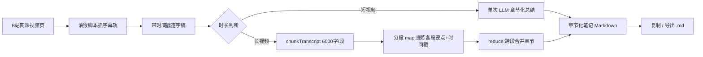

# 网课视频自动总结 · 可落地解决方案

> **输入**：B站网课视频（有 CC / AI 字幕轨）
> **输出**：按课程章节组织的结构化知识点笔记（Markdown）
> **落地形态**：复用现有 `bilibili-caption-summary.user.js` 油猴脚本，做增量扩展，**不新开独立工具**
> **文档定位**：个人自用 · 只针对 B站 · 需要登录

---

## 一、方案总览

**一句话链路**：在 B站网课页面用已有的油猴脚本抓取字幕轨 → 得到带时间戳的完整逐字稿 → 长视频按 6000 字分段（map-reduce）→ 调用 DeepSeek 按「章节化笔记」提示词做结构提炼 → 导出 Markdown 章节笔记。



核心复用的是现有脚本已有的三个能力：**字幕抓取（WBI 签名 + 降级接口）**、**逐字稿生成**、**DeepSeek 调用与长文分段（`chunkTranscript` / `buildSummaryPrompt`）**。本次改造只新增「**章节化笔记**」这一输出模式。

---

## 二、工具清单

| 工具 / 组件 | 作用 | 是否已有 | 成本 |
| --- | --- | --- | --- |
| Tampermonkey（篡改猴） | 在浏览器里运行用户脚本的宿主扩展 | 需用户安装 | 免费 |
| `bilibili-caption-summary.user.js` | 本体：抓字幕 / 出逐字稿 / 调 LLM / 导出 | ✅ 已有（1937 行 / 68KB 单文件） | 免费 |
| B站字幕接口 `/x/player/wbi/v2`（失败降级 `/x/player/v2`） | 获取 CC / AI 字幕轨 JSON | ✅ 已实现（含内联 MD5 + WBI 签名） | 免费，需登录 |
| DeepSeek API（`https://api.deepseek.com/v1`，`deepseek-chat`） | 逐字稿 → 章节化笔记的语义提炼 | ✅ 已接入，仅需填 Key | 按量计费，单次总结远低于 1 分钱 |
| Edge / Chrome 浏览器 | 运行环境 | 已有 | 免费 |
| 桌面快捷方式 `访谈类视频总结工具.lnk` | Edge `--app` 模式打开 B站，接近独立应用体验 | ✅ 已有 | 免费 |
| （可选兜底）faster-whisper | 无字幕视频的本地音频转写 | ❌ 未实现，仅说明 | 免费，需本地算力 |
| （可选兜底）通义听悟 | 在线音频转写 | ❌ 未实现，仅说明 | 有免费额度 |

---

## 三、具体操作流程（从零到产出笔记）

**准备（一次性）**

1. 在 Edge / Chrome 扩展商店安装 **Tampermonkey**。
2. Tampermonkey「管理面板」→「+」新建脚本 → 把 `bilibili-caption-summary.user.js` 全文粘贴覆盖 → `Ctrl + S` 保存。
3. 打开 **platform.deepseek.com** 注册登录 → 「API Keys」→ 创建并复制 `sk-...`。
4. 打开任意 B站视频页，在脚本面板「设置」标签填入：API Base URL `https://api.deepseek.com/v1`、API Key、模型 `deepseek-chat` → 点「保存设置」。

**每次做笔记**

5. **先登录 B站账号**（未登录时字幕接口会返回空数组，这是已知硬约束）。
6. 打开目标网课视频页（`https://www.bilibili.com/video/...`；番剧用 `/bangumi/play/`，分 P 用 `?p=n`）。
7. 面板「字幕」标签 → 多语言时选字幕轨 → 点「**抓取字幕**」。成功后会看到视频上叠加的实时字幕。
8. 切到「**逐字稿**」标签，确认全文完整（可勾选「显示时间戳」）。
9. 切到「**总结**」标签 → **选择「章节化笔记」模式**（本次新增，见第四节）→ 点「生成总结」。长视频会显示「正在总结 2/5 段…」进度。
10. 完成后点「**复制总结**」或「**导出 Markdown**」，得到 `课程标题_章节笔记.md`。

> 小技巧：看完视频再总结更省心——播到结束时脚本会弹「逐字稿已就绪」，可直接点「生成总结」。

---

## 四、如何实现（核心 · 增量改造点）

现有脚本的 AI 总结是「通用视频向」的固定结构（一句话概括 / 核心观点 / 内容脉络 / 关键结论与行动项 / 金句摘录）。本次**不改动抓字幕与逐字稿链路**，只在其上新增「章节化笔记」模式，改造点清单如下：

| # | 改造点 | 说明 |
| --- | --- | --- |
| 1 | 新增模式开关 | 在「总结」标签加一个选择器：`通用总结` / `章节化笔记`，默认沿用通用；模式值存入 `state.settings.summaryMode` |
| 2 | 新增章节化提示词 | 新增 `CHAPTER_TEMPLATE` 与 `buildChapterPrompt(text, opts)`（不改动原 `buildSummaryPrompt`，保证向后兼容） |
| 3 | 复用分段机制 | 短视频直接单次调用；长视频复用 `chunkTranscript(cues, 6000)` 分段 |
| 4 | 章节合并策略 | reduce 阶段在 `buildChapterPrompt` 的 `mode: 'merge'` 分支里做跨段章节归并（见 4.3） |
| 5 | 输出装配 | 生成前端拼装 Markdown 骨架（标题 / 总览 / 各章 / 速览表 / 复习清单） |
| 6 | 导出 | 复用现有 Markdown 导出，文件名带 `_章节笔记` 后缀 |

### 4.1 「章节化笔记」提示词设计（可直接交付工程师）

**System Prompt**（可复用现有 `SYSTEM_PROMPT` 精神，微调为教学场景）：

```
你是一名严谨的中文课程笔记整理助手，擅长把网课逐字稿整理成结构化的章节笔记。
要求：
1. 使用简体中文与 Markdown 格式；
2. 严格忠于逐字稿，不编造未出现的信息；
3. 笔记按「章 → 节 → 知识点 → 要点」分层，层级清楚；
4. 能识别讲师的章节切换信号（如"接下来我们看…""第二个部分""总结一下"）来划分章节；
5. 每个知识点尽量保留对应的 [时间戳]。
```

**User Prompt 模板**（占位符 `{{transcript}}` / `{{title}}`，与现有模板风格一致）：

```
课程标题：{{title}}

请阅读以下网课逐字稿（每行开头为 [时间戳]），整理成**章节化笔记**，必须严格使用如下 Markdown 结构：

# {{title}}

## 一句话总览
（用 1-2 句话概括本课讲什么、学完能掌握什么）

## 章节笔记
### <章节标题>  [起始时间戳]
- **核心目标**：…
- **知识点**
  - 要点1
  - 要点2
- **示例 / 演示**：…
- **小结**：…

## 关键概念速览
| 概念 | 一句话解释 | 出处时间戳 |

## 复习清单
- [ ] 关键知识点1
- [ ] 关键知识点2

规则：
- 章节标题请自行归纳，不要照抄口语；
- 每章至少 2 个知识点，知识点用要点列表展开；
- 无法确定时间戳时留空，不要编造。

逐字稿如下：

{{transcript}}
```

### 4.2 输出模板（Markdown 骨架）

```markdown
# {课程标题}

## 一句话总览
…

## 章节笔记

### 1. {章节标题}  [00:00:00]
- **核心目标**：…
- **知识点**
  - …
  - …
- **示例 / 演示**：…
- **小结**：…

### 2. {章节标题}  [00:12:30]
…

## 关键概念速览
| 概念 | 一句话解释 | 时间戳 |
| --- | --- | --- |
| … | … | 00:03:12 |

## 复习清单
- [ ] …
- [ ] …
```

### 4.3 长视频分段下章节如何跨段合并

长视频走 `chunkTranscript` → 每段 6000 字，存在**同一章被切到两段**、**章节边界落在段中间**的问题。合并策略（在 reduce 阶段实现）：

1. **分段 map**：每段只输出「本段识别到的章节 + 各章知识点 + 首条时间戳」，**不要**自行下总结论，段落结尾的残缺章节标注为「（未完）」。
2. **边界缝合**：reduce 时按时间戳排序，若上一段末尾章节标「（未完）」且下一段开头章节时间连续，则判定为同章，把内容**追加**而非新建章节。
3. **标题归一**：同一章在不同段可能被起不同标题，用「首个出现的标题为准」，其余作为同章内容并入。
4. **全局重排**：缝合后按各章首时间戳升序排列，重新编号，最后再生成「关键概念速览」与「复习清单」（这两部分是**全局汇总**，只在最后一步生成，避免重复）。

> 实现建议：map 阶段复用现有 `mode: 'detail'` 思路（提炼要点、保留时间戳）；reduce 阶段新增 `mode: 'chapter-merge'` 分支，把各段结构化结果（而非纯文本）拼起来交给 LLM 做归并。

### 4.4 与现有「通用总结」模式共存

- **不改动**原 `buildSummaryPrompt` 的 `final / detail / merge` 行为，确保现有 QA 单例（110 条）继续通过。
- 新增独立的 `buildChapterPrompt`，通过 `state.settings.summaryMode`（`'general' | 'chapter'`）在生成入口分流。
- UI 上只是「总结」标签多一个下拉框，默认 `general`，老用户行为完全不变。
- 导出文件名区分：通用 → `_总结.md`，章节化 → `_章节笔记.md`。

---

## 五、输出示例（虚构课程片段）

> 以《数据库原理 · 第 3 讲 关系模型与范式》为例，展示最终笔记长什么样。

```markdown
# 数据库原理 · 第3讲 关系模型与范式

## 一句话总览
本讲介绍关系模型的基本概念，并讲解如何通过 1NF/2NF/3NF 逐步消除数据冗余，
学完能独立判断一张表处于第几范式并做规范化拆分。

## 章节笔记

### 1. 关系模型是什么  [00:00:15]
- **核心目标**：理解"表=关系"的基本直觉
- **知识点**
  - 关系（Relation）就是一张二维表；行叫元组，列叫属性
  - 主键用于唯一标识一行，不能重复、不能为空
  - 外键用于表达表之间的引用关系
- **示例 / 演示**：以"学生表 + 选课表"演示主键与外键
- **小结**：一切从"表"出发，先能读懂表结构

### 2. 函数依赖与范式动机  [00:08:40]
- **核心目标**：理解为什么要做规范化
- **知识点**
  - 函数依赖：X 决定 Y，记作 X→Y
  - 数据冗余会带来插入异常、更新异常、删除异常
  - 规范化的本质是"用拆分换一致性"
- **示例 / 演示**：一张"学生选课"宽表逐步暴露冗余问题
- **小结**：范式不是目的，消除异常才是

### 3. 1NF / 2NF / 3NF  [00:21:05]
- **核心目标**：掌握三范式的判定与拆分
- **知识点**
  - 1NF：每个属性不可再分（不能有"电话1/电话2"）
  - 2NF：在 1NF 基础上，消除非主属性对码的部分依赖
  - 3NF：在 2NF 基础上，消除非主属性对码的传递依赖
- **示例 / 演示**：三步拆分同一张宽表，逐步达标 3NF
- **小结**：先看是否可再分，再看部分依赖，最后看传递依赖

## 关键概念速览
| 概念 | 一句话解释 | 时间戳 |
| --- | --- | --- |
| 关系 | 一张二维表 | 00:01:20 |
| 主键 | 唯一标识一行的属性 | 00:03:05 |
| 函数依赖 X→Y | X 决定 Y | 00:09:10 |
| 3NF | 消除传递依赖的范式 | 00:24:30 |

## 复习清单
- [ ] 能说清主键 / 外键的区别
- [ ] 能举出一个违反 2NF 的例子
- [ ] 能把一张宽表拆到 3NF
```

---

## 六、能力边界与限制条件

| 限制 | 说明 | 应对 |
| --- | --- | --- |
| 仅支持 B站 | 抖音 / 腾讯视频 / 爱奇艺无稳定字幕接口 | 换平台需另做方案（未实现） |
| **必须登录 B站** | 未登录时字幕接口返回空数组 | 用前先登录，再刷新视频页 |
| 依赖 up 主有字幕 | up 主未传 CC、也未开 AI 字幕 → 无字幕可抓 | 走「音频转写」兜底（见第七节） |
| WBI 风控 `-352` | 接口校验失败 | 脚本已自动降级到 `/x/player/v2`；仍失败则等几分钟重试 |
| protobuf 字幕 | 个别轨只给 `subtitle_urls` 数组 | 脚本跳过并提示不支持 |
| API 成本 | DeepSeek 按量计费，长视频分段后调用次数增多 | 单次成本仍极低；可开缓存避免重复总结 |
| **版权** | 逐字稿与笔记源自他人课程 | **仅限个人学习**，勿传播逐字稿 |

---

## 七、可选扩展路径（均标注「未实现」）

| 想覆盖的场景 | 需要增加 | 状态 |
| --- | --- | --- |
| 无字幕 B站视频 | 音频捕获 + 本地 **faster-whisper** 转写 | 未实现 |
| 在线转写替代 | 接 **通义听悟** 等在线 ASR | 未实现 |
| 本地视频文件 | 读取本地文件 → Whisper 转写 → 复用同一套章节化提示词 | 未实现 |
| 其他视频平台 | 各平台各自的字幕抓取适配 | 未实现 |
| 做成独立工具 | 从零开发 / Electron 桌面应用 | 用户明确不需要 |

---

## 八、交付小结（给团队）

- **不改链路，只加模式**：字幕抓取、逐字稿、分段、DeepSeek 调用全部复用；新增「章节化笔记」模式开关、`CHAPTER_TEMPLATE`、`buildChapterPrompt`、跨段章节合并。
- **改造点 6 项**见第四节表格；提示词与输出模板见 4.1 / 4.2，可直接交工程师实现。
- **兼容性要求**：原 `buildSummaryPrompt` 与 110 条 QA 单例必须保持通过。
- **核心风险**：必须登录 B站、up 主须有字幕；无字幕走兜底（本期不实现）。
